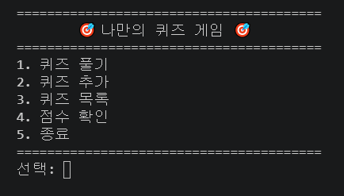
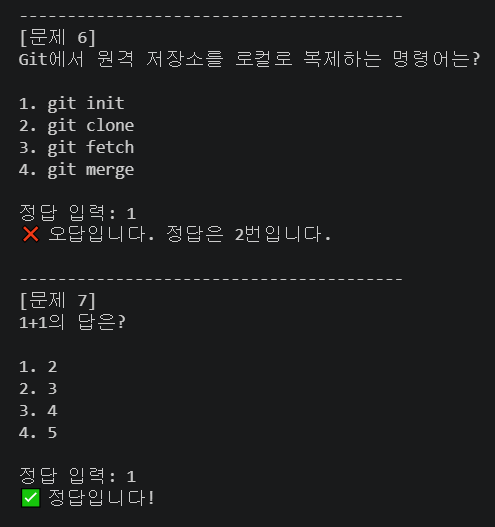
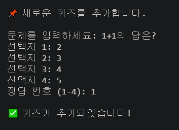
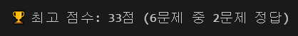

# 🎯 나만의 퀴즈 게임

터미널에서 동작하는 Python 콘솔 퀴즈 게임입니다.
클래스(객체 지향)로 역할을 나누고, `state.json` 에 퀴즈와 최고 점수를 저장하여 프로그램을 종료해도 데이터가 유지됩니다.

## 프로젝트 개요
- Python 3.10+ 표준 라이브러리만 사용 (외부 라이브러리 없음)
- `Quiz`(문제 1개)와 `QuizGame`(게임 전체 관리) 두 클래스로 구성
- JSON 파일 저장/불러오기, 입력 검증, 예외 처리(`try/except`) 적용
- Git 브랜치/병합, clone/pull 로 변경 이력을 관리

## 퀴즈 주제와 선정 이유
**주제: 파이썬 & Git 기초**
이 과제에서 직접 배우는 내용(자료형, 리스트, 클래스, Git 명령어)을 퀴즈로 만들면 게임을 풀면서 복습이 되기 때문에 선택했습니다.

## 실행 방법
```bash
python main.py
```
Python 3.10 이상이 필요합니다. (`python --version` 으로 확인)

## 기능 목록
| 메뉴 | 기능 |
|------|------|
| 1. 퀴즈 풀기 | 저장된 퀴즈를 순서대로 출제, 정답/오답 안내, 결과 및 최고 점수 갱신 |
| 2. 퀴즈 추가 | 문제 + 선택지 4개 + 정답 번호 입력 후 즉시 `state.json` 에 저장 |
| 3. 퀴즈 목록 | 등록된 퀴즈 문제 목록 확인 |
| 4. 점수 확인 | 저장된 최고 점수 확인 (기록이 없으면 안내) |
| 5. 종료 | 저장 후 종료 |

입력/예외 처리
- 입력 앞뒤 공백 제거, 빈 입력·숫자 아님·범위 밖 숫자는 안내 후 재입력
- `Ctrl+C`, 입력 종료(EOF) 시에도 저장 후 안전하게 종료
- `state.json` 이 없으면 기본 퀴즈 사용, 손상되었으면 안내 후 기본 퀴즈로 초기화

## 파일 구조
```
quiz-game/
├── main.py             # 프로그램 진입점
├── quiz.py             # Quiz 클래스 (문제, 선택지, 정답)
├── quiz_game.py        # QuizGame 클래스 (메뉴, 게임 진행, 저장/불러오기)
├── input_utils.py      # 공통 입력 처리 함수 (read_text, read_int)
├── default_quizzes.py  # 기본 퀴즈 데이터 (파이썬/Git 6문제)
├── state.json          # 퀴즈와 최고 점수 저장 파일
├── .gitignore
└── README.md
```

## 데이터 파일 (`state.json`)
- 경로: 프로젝트 루트 `state.json` (UTF-8)
- 역할: 퀴즈 목록과 최고 점수를 저장해 재실행 후에도 유지

| 필드 | 설명 |
|------|------|
| `quizzes` | 퀴즈 목록. 각 항목은 `question`(문제), `choices`(선택지 4개), `answer`(정답 번호 1~4) |
| `best_score` | 최고 점수를 낸 판의 정답 수 (기록이 없으면 `null`) |
| `best_total` | 그 판의 전체 문제 수 (점수 = 정답 수 / 문제 수 × 100) |

```json
{
    "quizzes": [
        {"question": "Python의 창시자는?", "choices": ["Guido van Rossum", "Linus Torvalds", "Bjarne Stroustrup", "James Gosling"], "answer": 1}
    ],
    "best_score": 3,
    "best_total": 6
}
```

## 실행 화면
| 메뉴 | 퀴즈 풀기 |
|------|-----------|
|  |  |

| 퀴즈 추가 | 점수 확인 |
|-----------|-----------|
|  |  |

> 이미지는 `docs/screenshots/` 폴더에 위 파일명으로 저장하면 표시됩니다.

> GitHub clone 저장소에서 추가한 한 줄 (clone/pull 실습)
